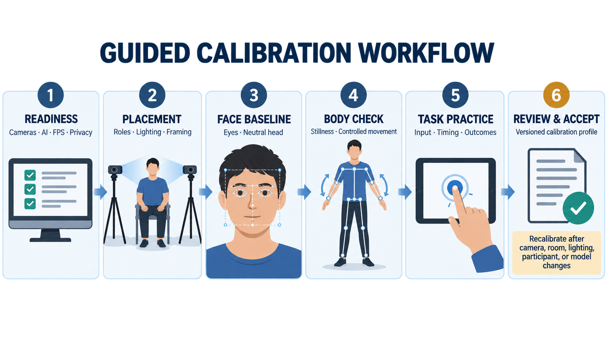

# Calibration, Validation, and Documentation Plan

Iris, mouth, and face-contour selections are **visual overlays only** in this release. They are not gaze, expression, mouth, or diagnostic measurements. Only Eyes and Head Pose are enabled as face measurement groups.

This is the implementation and commissioning checklist after the core Main Server and Raspberry Pi camera node are operational. It distinguishes software completion from real-world measurement validation.

## Current verified baseline

- Main Server core, dashboard, settings, sessions, authentication, database, reports, exports, and Attention Task are implemented.
- Raspberry Pi camera-node service is installed, enabled at boot, and reachable at `adhd-camera.local:8090`.
- Two Logitech C505 cameras have stable serial-based Face and Body assignments.
- Both outgoing streams decode at exactly `360x240`; the physical cameras negotiate `320x240` at approximately 15 FPS when used together.
- Main Server integration has reported both network streams connected with zero failed frames during the commissioning check.
- Automated software suite: 43 passing tests.
- These checks prove connectivity and software behavior; they do not prove research measurement accuracy.

## Priority 0 — Required before calibration

1. Restart the elevated port-8000 Main Server so it loads the Raspberry Pi stream URLs already saved in `.env`.
2. Confirm in Live Monitor that serial `B04D0170` is physically the Face camera and serial `8DACA170` is physically the Body camera. Swap the role paths if the views are reversed.
3. Mount both cameras according to `PHYSICAL_CAMERA_SETUP.md` and confirm stable, unobstructed framing.
4. Verify the tablet and laptop use the same trusted network and that no Pi camera-node port is forwarded to the public internet.
5. Change the temporary/simple Raspberry Pi password now that dedicated SSH-key access is working.

## Priority 1 — Software and UI improvements

### 1. Requested versus actual camera telemetry

The UI and reports must show both values separately:

- Requested output: width, height, and target FPS.
- Physical capture: negotiated width, height, and measured source FPS.
- Main Server receive: decoded width, height, receive FPS, latency, dropped frames, and failures.

Never label a 30 FPS target as 30 physical FPS when the webcam supplies approximately 15 unique frames per second.

### 2. Per-camera configuration

Replace the one shared camera profile with independent Face and Body settings:

- Source URL/device
- Requested output width and height
- Target FPS
- Rotation and horizontal mirror
- Exposure/brightness controls when supported
- Processing FPS
- Preview and role-identification action

The Face camera should be allowed a higher resolution/FPS than the Body camera because blink detection has tighter temporal and spatial requirements.

### 3. Guided calibration wizard

Add a step-by-step researcher workflow:

1. Room and lighting check
2. Face framing check
3. Body framing/keypoint visibility check
4. Neutral eye-open baseline
5. Deliberate blink sample
6. Neutral head-pose baseline
7. Left/right/up/down head movement sample
8. Still-body baseline
9. Controlled arm/torso/posture movements
10. Attention Task practice and timing check
11. Review calculated thresholds
12. Save or reject the calibration profile

### 4. Calibration profile persistence

Store a versioned calibration snapshot with:

- Profile ID, participant/session scope, date/time, researcher, room/setup note
- Camera serials, source paths, requested and actual telemetry
- EAR baseline and threshold
- Blink timing parameters
- Neutral yaw/pitch/roll offsets and movement threshold
- Body baseline noise, regional movement thresholds, posture threshold
- Pose/keypoint confidence values
- Landmark profile and feature selections
- Software/configuration version and deterministic hash

Lock the snapshot to a running session so mid-session setting changes cannot alter interpretation.

### 5. Quality gates and warnings

Block or warn before recording when:

- Face or Body camera is offline/reconnecting
- Face is missing or more than one face is present
- Required body keypoints are not visible
- Physical/source FPS is below the validated minimum
- Frame latency or failure count exceeds limits
- Lighting is unstable or face exposure is unusable
- No accepted calibration profile is selected
- Camera roles/serials differ from the saved profile

## Priority 2 — Physical calibration protocol

## Face and blink calibration

1. Seat the participant using the physical setup guide.
2. Record 10–15 seconds of natural eyes-open baseline without saving raw video.
3. Collect 8–10 deliberate normal blinks while an observer manually counts them.
4. Calculate participant baseline EAR distribution; do not assume `0.21` is correct for everyone.
5. Choose a threshold below the stable open-eye baseline and validate against the deliberate blink sample.
6. Verify that normal gaze changes, eyeglasses, and minor head turns do not create false blinks.
7. Recalibrate after material camera distance, angle, zoom, lighting, or eyewear changes.

Suggested initial acceptance check: every manual blink has one matching detected blink, with no repeated counts for one closure. Formal sensitivity/specificity targets must be defined in the research protocol before data collection.

## Head-pose calibration

1. Capture neutral forward pose and store yaw/pitch/roll offsets.
2. Ask for controlled left, right, up, and down movements.
3. Confirm sign/direction labels and magnitude response.
4. Tune smoothing and the current 12-degree event threshold to prevent jitter counts while preserving deliberate movement.
5. Verify that returning to center does not double-count unless the protocol explicitly defines it as a separate event.

## Body and posture calibration

1. Verify the required keypoints are visible at rest.
2. Measure 10–15 seconds of still-body baseline noise.
3. Perform known movements: left arm, right arm, torso lean, leg/foot movement, and posture change.
4. Tune movement threshold above camera/noise jitter and below deliberate-movement magnitude.
5. Validate seated posture angle and posture-change event logic.
6. Repeat after moving the chair, body camera, or lighting.

## Attention Task calibration

1. Run practice mode before recorded trials.
2. Test keyboard and tablet touch independently.
3. Compare known stimulus/response timestamps with stored reaction times.
4. Verify correct, incorrect, missed, paused, aborted, and reconnect outcomes.
5. Confirm every result attaches to the intended participant and active session.

## Priority 3 — Manual accuracy validation

Use controlled sessions with synchronized manual annotation:

- Manual blink count versus detected blink count
- Manual head-movement events versus detected events
- Manual regional body events versus detected events
- Known posture changes versus detected posture changes
- Known Attention Task responses versus stored outcomes/timestamps

Report true positives, false positives, false negatives, event timing error, reaction-time error, and usable-frame percentage. Do not claim ADHD detection or clinical diagnostic accuracy.

## Priority 4 — Reliability and recovery tests

- 30-minute initial continuous session
- 1–2 hour endurance session
- Raspberry Pi reboot and automatic service recovery
- Main Server restart and session recovery behavior
- One camera unplug/replug at a time
- Ethernet/Wi-Fi interruption and recovery
- Router reboot
- Tablet disconnect/reconnect
- Database backup and clean restore drill
- Power interruption simulation outside an active participant session
- Temperature, CPU, memory, source FPS, latency, failure, and dropped-frame logging

## Documentation image set

The full documentation should use an image or annotated screenshot for nearly every operator-facing procedure:

1. Overall topology
2. Complete physical room layout
3. Face-camera placement and correct/incorrect framing
4. Body-camera placement and keypoint visibility
5. Correct participant posture
6. Lighting: correct versus backlit/uneven
7. Raspberry Pi ports, camera USB connections, Ethernet, and power
8. Raspberry Pi OS/SSH setup
9. Stable camera serial mapping
10. Camera-node health and stream URLs
11. Main Server installation and startup
12. Login/access-key screen
13. Overview page walkthrough
14. Live Monitor and camera-role confirmation
15. Settings and per-camera configuration
16. Landmark profile selection
17. Guided face/blink calibration
18. Guided head-pose calibration
19. Guided body/posture calibration
20. Attention Task practice and recorded workflow
21. Records, reports, exports, and deletion
22. Hardware validation page
23. Backup and restore
24. Troubleshooting decision tree
25. Privacy, cable safety, and research-only limitations

Use real application screenshots where available. Use generated diagrams only for physical arrangements, concepts, or states that cannot be captured clearly. Blur or replace participant identifiers and never include access keys, passwords, raw participant frames, or private network secrets.

## Definition of completion

The system is ready for a controlled pilot only when:

- Both camera roles and framing are confirmed.
- A calibration profile is accepted and attached to the test session.
- Manual controlled-event validation meets protocol-defined thresholds.
- A 30-minute session completes without unrecovered camera/server failure.
- Reboot/reconnect tests pass.
- Backup restoration is demonstrated.
- Researcher and participant operating guides are reviewed.
- Privacy/consent and non-diagnostic limitations are documented.
