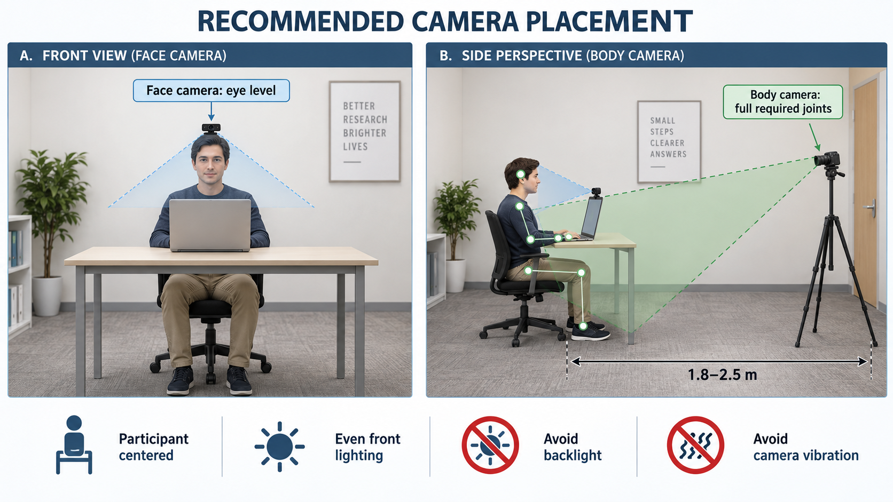

# Physical Camera and Participant Setup

Use this guide before calibration or recording a research session.

## Participant position

- Sit upright on a stable armless chair.
- Face and eyes point forward; avoid tilting the head at baseline.
- Keep shoulders relaxed and hands resting naturally on the thighs.
- Keep both feet flat on the floor and knees near 90 degrees.
- Keep the chair and participant centered on the shared camera centerline.

## Face camera

- Place directly in front of the participant at eye level.
- Set the face camera at approximately **40 cm** from the face; the calibration guide accepts **35–45 cm** as the green placement band.
- Frame the full face, both eyes, jaw, and upper shoulders.
- Keep the face centered with even diffuse front lighting.

## Body camera

- Place directly in front and approximately 1.8–2.5 m away.
- Start with the lens approximately 1.0–1.3 m above the floor.
- Frame the head, shoulders, arms, hands, hips, knees, and feet.
- Use an armless chair and keep the area around the body silhouette clear.

## Room and safety

- Use a plain, uncluttered background and avoid strong backlighting.
- Stabilize both cameras; camera vibration can create false movement events.
- Keep the two cameras from blocking each other's view.
- Route USB and power cables away from the participant's feet.
- Keep the Raspberry Pi ventilated and outside the participant movement area.

## Calibration note

The distances are starting points, not universal fixed values. Confirm the actual Face and Body previews, then calibrate eye-open baseline, neutral head pose, detection confidence, and movement thresholds for the room and participant. This setup supports objective research measurements and is not a diagnostic configuration.
