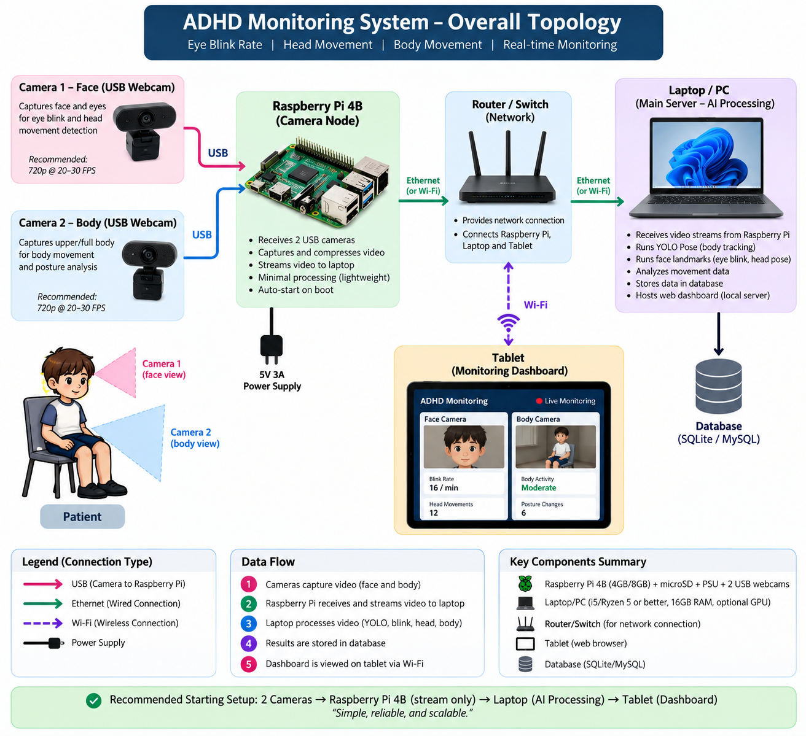

# ADHD Behavioral Monitoring System — Master Build Specification

> **Single source of truth:** Use this document for all future implementation work in this folder. Preserve its research-only, privacy, safety, architecture, milestone, and testing requirements. Update this file when requirements materially change so details do not need to be repeated in chat.

> **Example project location:** `C:\Behavior-Monitor-Research-Console-CLEAN`

> **Status (2026-09-16):** Phases 1–12 are implemented. Phase 13 software tooling is implemented for hardware readiness, with physical Pi/two-camera commissioning pending. Phase 14 adds research exports and backup; Phase 15 adds authentication and audit history. The dashboard, researcher login, and participant Attention Task have professional compact, responsive, theme-aware workflows. Primary navigation now uses separate Overview, Live Monitor, Attention, and Records pages; Overview is a detailed command center without duplicating full workflows. Landmark configuration now supports Core Monitoring, Upper Body, Full Body, and Custom profiles; separate Display/Measure groups; derived-feature selection; dependency validation; session locking; versioned configuration snapshots; and deterministic hashes in session exports. The feature selection gates overlays, regional post-processing, and synchronized persistence without adding inference passes or claiming an untrained temporal model. The automated suite has 43 passing tests and JavaScript syntax validation passes.

## Authoritative System Topology

The topology image supplied by the project owner is the authoritative physical and network architecture reference:



### Physical and network layout

```text
Camera 1 — Face USB Webcam ─┐
                            ├─USB─> Raspberry Pi 4B (camera/streaming node)
Camera 2 — Body USB Webcam ─┘                    │
                                                 │ Ethernet preferred (Wi-Fi optional)
                                                 v
                                         Router / Switch
                                                 │
                              ┌──────────────────┴──────────────────┐
                              │ Ethernet preferred                 │ Wi-Fi/LAN
                              v                                    v
                    Windows Laptop / PC                         Tablet
                    Main AI Server                       Monitoring Dashboard
                              │
                              v
                    Local SQLite database
                    (MySQL may be considered later)
```

### Component responsibilities

- **Camera 1 — Face:** captures the face and eyes for facial landmarks, eye-blink measurements, and head-pose/head-movement measurements. Recommended starting capture is 720p at 20–30 FPS.
- **Camera 2 — Body:** captures the participant's upper or full body for pose, movement, posture, and experimental repetitive-movement measurements. Recommended starting capture is 720p at 20–30 FPS.
- **Raspberry Pi 4B:** receives both USB cameras, captures and compresses video, and streams both feeds over the LAN. It performs minimal processing, should support automatic startup, and does not initially run YOLO or the main AI pipeline. Use an appropriate 5V/3A power supply.
- **Router/Switch:** connects the Raspberry Pi, Windows server, and tablet. Prefer wired Ethernet for Pi-to-server transport; Wi-Fi remains optional where needed.
- **Windows Laptop/PC:** receives the two streams, runs face landmarks, blink analysis, head pose, YOLO Pose, body-movement analysis, session management, database services, FastAPI, WebSockets, attention task, reports, and the local web dashboard.
- **Tablet:** connects over Wi-Fi/LAN and displays the browser-based monitoring dashboard. It is a dashboard client, not the AI-processing device.
- **Database:** runs locally with the main server. SQLite is the prototype default; any later MySQL migration must preserve the repository/database abstraction.

### Participant camera views

- Camera 1 is aimed at the participant's face.
- Camera 2 is framed for the participant's upper or full body.
- The two camera feeds must remain logically separate from capture through processing and dashboard display.

### Required data flow

1. Both cameras capture face and body video.
2. The Raspberry Pi receives and streams both video feeds to the Windows laptop/PC.
3. The laptop processes face, blink, head, pose, and body-movement signals.
4. The laptop stores derived measurements and session/task records in the local database; raw-video recording remains off by default.
5. The tablet opens the monitoring dashboard served by the laptop over the local network.

### Development-stage exception

The final topology above must not block development. Until Raspberry Pi integration is ready, either or both USB cameras may connect directly to the Windows laptop. Camera sources must remain configurable so local indexes such as `0` and `1` can later be replaced with Raspberry Pi network-stream URLs without changing the vision modules.

---

You are a senior Python computer-vision, backend, and frontend engineer.

Build a complete working prototype called:

ADHD Behavioral Monitoring System

IMPORTANT:
This application is a research/behavioral monitoring tool. It must NOT diagnose ADHD or output "ADHD / Not ADHD". It only records and displays objective behavioral measurements and computerized attention-task performance for later researcher/clinician review.

==================================================
1. SYSTEM ARCHITECTURE
==================================================

The final physical architecture is:

Camera 1 (Face USB Webcam)
        |
        | USB
        v
Raspberry Pi 4B
        |
Camera 2 (Body USB Webcam)
        |
        | USB
        v
Raspberry Pi 4B
        |
        | Ethernet / LAN
        v
Router / Switch
        |
        v
Windows Laptop / PC
(Main AI Server)
        |
        +-- Computer Vision
        +-- Session Management
        +-- Database
        +-- REST/WebSocket API
        +-- Attention Task
        +-- Web Dashboard
        |
        +------ Wi-Fi/LAN ------> Tablet Browser

The Raspberry Pi will eventually act mainly as a lightweight camera node.

The Windows laptop/PC performs the heavy AI processing.

However, DEVELOPMENT MUST WORK WITHOUT THE RASPBERRY PI.

During development, allow Camera 1 and Camera 2 to be connected directly to the Windows laptop via USB.

Design the camera input layer so we can later change each source from:

USB camera index:
0
1

to network streams from Raspberry Pi without rewriting the AI modules.

==================================================
2. DEVELOPMENT ENVIRONMENT
==================================================

Target OS:
Windows 10/11 64-bit

Target Python:
Python 3.11 if compatible with all selected dependencies.

Use a Python virtual environment.

Primary technologies:

Python
OpenCV
Ultralytics YOLO Pose
MediaPipe or another actively supported facial-landmark solution compatible with the chosen Python version
NumPy
SciPy where useful
FastAPI
Uvicorn
SQLAlchemy
SQLite
WebSockets
HTML
CSS
JavaScript

Use lightweight dependencies where possible.

Before choosing exact package versions, verify they are mutually compatible.

Create requirements.txt.

==================================================
3. PROJECT STRUCTURE
==================================================

Create a clean modular project approximately like:

adhd-monitoring/
│
├── README.md
├── requirements.txt
├── .gitignore
├── .env.example
├── run.py
│
├── app/
│   ├── __init__.py
│   ├── config.py
│   │
│   ├── camera/
│   │   ├── __init__.py
│   │   ├── camera_manager.py
│   │   ├── face_camera.py
│   │   └── body_camera.py
│   │
│   ├── vision/
│   │   ├── __init__.py
│   │   ├── face_landmarks.py
│   │   ├── blink_detector.py
│   │   ├── head_pose.py
│   │   ├── body_pose.py
│   │   └── movement_analyzer.py
│   │
│   ├── sessions/
│   │   ├── __init__.py
│   │   └── session_manager.py
│   │
│   ├── tasks/
│   │   ├── __init__.py
│   │   └── attention_task.py
│   │
│   ├── database/
│   │   ├── __init__.py
│   │   ├── models.py
│   │   ├── database.py
│   │   └── repository.py
│   │
│   ├── api/
│   │   ├── __init__.py
│   │   ├── routes.py
│   │   └── websocket.py
│   │
│   └── services/
│       └── monitoring_service.py
│
├── static/
│   ├── css/
│   │   └── style.css
│   └── js/
│       ├── dashboard.js
│       └── attention-task.js
│
├── templates/
│   ├── dashboard.html
│   ├── patients.html
│   ├── session.html
│   ├── attention-task.html
│   └── reports.html
│
├── data/
│   └── .gitkeep
│
└── tests/
    ├── test_blink.py
    ├── test_movement.py
    ├── test_database.py
    └── test_api.py

You may improve this architecture if necessary, but keep modules separated and maintainable.

==================================================
4. CAMERA MANAGEMENT
==================================================

Support TWO simultaneous cameras.

CAMERA 1 = FACE CAMERA

Purpose:
- face detection/tracking
- facial landmarks
- eye landmarks
- eye open/closed state
- blink detection
- blink rate
- head pose
- head movement

CAMERA 2 = BODY CAMERA

Purpose:
- person detection
- pose estimation
- body keypoints
- body movement
- posture changes
- fidgeting-related movement measurements

Camera configuration must be editable from config.

Example:

FACE_CAMERA_SOURCE=0
BODY_CAMERA_SOURCE=1

Allow sources to later become URLs such as:

FACE_CAMERA_SOURCE=http://raspberry-pi/face-stream
BODY_CAMERA_SOURCE=http://raspberry-pi/body-stream

Do not hard-code camera indexes throughout the application.

Initial target:
1280x720
20 FPS

Allow configuration to 640x480 for slower machines.

Handle:
- disconnected camera
- failed frames
- reconnection
- camera unavailable
- low FPS

Show camera status in dashboard.

==================================================
5. FACE LANDMARK DETECTION
==================================================

Use an appropriate facial-landmark model.

Detect important landmarks around:

left eye
right eye
nose
face contour

The module must expose normalized/structured landmark information to the rest of the system.

Avoid unnecessary identity recognition.

This system does NOT need facial recognition or person identification from biometric features.

==================================================
6. EYE BLINK DETECTION
==================================================

Implement blink detection using eye landmarks.

A suitable approach is Eye Aspect Ratio (EAR) or an equivalent landmark-based technique.

Calculate independently where appropriate:

Left Eye EAR
Right Eye EAR
Average EAR

Create configurable parameters such as:

EAR_THRESHOLD
MIN_CLOSED_FRAMES
REFRACTORY_PERIOD

Do NOT treat a single low-EAR frame as a blink.

A blink should require a valid closed-to-open sequence.

Measure:

total blinks
blinks per minute
blink timestamps
recent blink rate

Display live:

Blink Rate: XX / min
Total Blinks: XX

Include calibration support because eye geometry, camera distance, glasses, lighting, and face angle can affect measurements.

Do not claim a universal clinical blink threshold.

==================================================
7. HEAD POSE AND HEAD MOVEMENT
==================================================

Estimate:

Yaw
Pitch
Roll

Use facial landmarks and an appropriate head-pose estimation technique such as solvePnP if suitable.

Display live values.

Example:

Yaw: -8°
Pitch: +4°
Roll: +1°

Track movement events based on configurable changes over time.

Possible directional labels:

CENTER
LEFT
RIGHT
UP
DOWN

But preserve numerical yaw/pitch/roll measurements.

Measure:

head movement count
head movement magnitude
movement timestamps
movement per minute

Avoid counting normal landmark jitter as movement.

Use smoothing/filtering.

==================================================
8. BODY POSE
==================================================

Use Ultralytics YOLO Pose with an appropriately lightweight pose model.

Detect body keypoints such as:

shoulders
elbows
wrists
hips
knees
ankles

Display skeleton/keypoints optionally on the researcher dashboard.

The application should track one primary participant.

Do not implement identity recognition.

Provide a method to select/maintain the primary subject if another person temporarily enters the frame.

==================================================
9. BODY MOVEMENT ANALYSIS
==================================================

Create movement metrics based on keypoint displacement over time.

Normalize movement measurements where possible to body scale so camera distance has less influence.

Track useful regions separately:

head/shoulders
left arm
right arm
torso
left leg
right leg

Generate objective metrics such as:

movement magnitude
movement events
movement duration
movement per minute
posture-change events

Do NOT initially label the participant as medically "hyperactive".

If the UI uses labels such as Low/Moderate/High activity, make it explicit that these are system-defined descriptive activity bands, configurable and not diagnostic.

Keep the raw numerical measurements available.

Use smoothing and debounce logic to prevent camera/keypoint jitter from being counted as movement.

==================================================
10. FIDGETING MEASUREMENTS
==================================================

Implement experimental movement features for repeated/small movements.

Potential measurements:

wrist movement frequency
ankle/leg movement frequency
repetitive small keypoint displacement
frequent posture shifting

Name these features carefully.

Prefer:
"movement frequency"
"repetitive movement"
"activity measurement"

rather than asserting clinical fidgeting unless validated.

Store numerical values and timestamps.

==================================================
11. PATIENT / PARTICIPANT MANAGEMENT
==================================================

Create participant records.

Fields:

id
participant_code
optional display name
age or age group if the research protocol requires it
created_at

For privacy, encourage use of participant codes such as:

P001
P002
P003

Do not require storing a participant's face image.

Dashboard must allow:

Add Participant
Select Participant
View Sessions
Start New Session

==================================================
12. MONITORING SESSION
==================================================

A monitoring session belongs to one participant.

Store:

session_id
participant_id
start_time
end_time
duration
camera status
notes

During an active session display:

Participant ID
Session timer

Face Camera:
Tracking status
Blink Rate
Total Blinks
Yaw
Pitch
Roll
Head Movement Count

Body Camera:
Tracking status
Movement Magnitude
Movement Events
Posture Changes

Attention Task:
Correct
Incorrect
Missed
Average Reaction Time

Include:

START SESSION
STOP SESSION

Stopping a session should finalize and save its summary.

==================================================
13. COMPUTERIZED ATTENTION TASK
==================================================

Create a simple configurable attention/reaction task.

IMPORTANT:
Do not claim this is a validated diagnostic Continuous Performance Test unless a validated protocol is actually implemented and licensed/appropriate.

For prototype purposes call it:

"Attention Task"

Example task:

Display one stimulus at a time.

Example:

STAR = TARGET
CIRCLE = NON-TARGET

Instruction:

"Press SPACE when you see the STAR.
Do not press when you see the CIRCLE."

Randomize stimuli according to configurable settings.

Store for every trial:

trial number
stimulus
target/non-target
stimulus timestamp
response timestamp
reaction time
correct
incorrect
missed
false response

Calculate:

total trials
correct responses
incorrect responses
missed targets
false responses
accuracy
average reaction time
reaction-time variability

Provide a fullscreen participant-friendly task screen.

IMPORTANT:
The child/participant must NOT see the researcher monitoring statistics while performing the task.

==================================================
14. SYNCHRONIZATION
==================================================

This is very important.

Use a common session clock/timestamp so that:

attention-task events
blinks
head movements
body movements
posture changes

can be compared on the same timeline.

Example:

12.420 sec - Target appears
13.031 sec - Correct response
13.031 sec - Reaction time 611 ms
13.520 sec - Blink
14.100 sec - Head movement
14.800 sec - Body movement event

Use monotonic timing for interval calculations where appropriate and wall-clock timestamps for persistent records.

==================================================
15. DATABASE
==================================================

Use SQLite initially through SQLAlchemy.

Design tables approximately for:

participants
sessions
blink_events
head_pose_samples
head_movement_events
body_movement_samples/events
posture_events
attention_trials
session_summaries

Do NOT write every raw video frame to the database.

Use sensible sampling/aggregation for continuous metrics.

Indexes should be added for:

session_id
participant_id
timestamps

==================================================
16. PRIVACY
==================================================

Default behavior:

DO NOT permanently record raw video.

Process video in memory.

Store derived measurements and timestamps.

Provide a configuration option for research-approved recording if it is ever required, but default it to OFF.

Do not implement face recognition.

Do not upload video/data to external cloud services.

Keep prototype data local.

Include documentation stating that informed consent/guardian consent and appropriate institutional/ethics approval are required when used with real participants, especially children.

==================================================
17. FASTAPI SERVER
==================================================

Create a FastAPI application.

Provide REST endpoints approximately like:

GET /api/health

GET /api/participants
POST /api/participants

GET /api/sessions
POST /api/sessions/start
POST /api/sessions/{id}/stop

GET /api/sessions/{id}
GET /api/sessions/{id}/summary

GET /api/cameras/status

GET /api/reports/{session_id}

Use WebSocket(s) for live monitoring data.

Example:

/ws/monitor

Send updates such as:

{
  "session_time": 124.2,
  "face_tracking": true,
  "body_tracking": true,
  "blink_rate": 17,
  "total_blinks": 34,
  "yaw": -4.2,
  "pitch": 2.1,
  "roll": 0.8,
  "head_movements": 12,
  "body_movement": 0.31,
  "posture_changes": 4,
  "task_accuracy": 82.0,
  "reaction_time_ms": 620
}

==================================================
18. TABLET DASHBOARD
==================================================

Create a responsive web dashboard optimized for:

Laptop
Desktop
Tablet

The tablet will access the server using the laptop's LAN IP.

Example:

http://192.168.1.100:8000

The dashboard should have a professional research/medical-tech appearance but should not imply diagnosis.

Top:

Behavioral Monitoring System
Participant ID
Session Timer
Start / Stop

Then two main cards:

FACE CAMERA

Live preview
Tracking status
Blink Rate
Total Blinks
Yaw
Pitch
Roll
Head Movement Count

BODY CAMERA

Live preview
Tracking status
Movement Score/Magnitude
Movement Events
Posture Changes

Below:

REAL-TIME TIMELINE/GRAPHS

Blink events
Head movement
Body movement
Task events

ATTENTION TASK RESULTS

Correct
Incorrect
Missed
Accuracy
Average Reaction Time

Use responsive CSS.

==================================================
19. REPORTS
==================================================

After a session generate an on-screen report.

Include:

Participant Code
Date
Start Time
Duration

Blink:
total
average rate
timeline

Head:
movement count
yaw/pitch/roll summary
movement timeline

Body:
movement metrics
posture changes
timeline

Attention Task:
total trials
correct
incorrect
missed
false responses
accuracy
average reaction time
reaction-time variability

Add researcher notes.

Include this visible disclaimer:

"These measurements describe observed behavioral and task-performance signals and are not, by themselves, a diagnosis of ADHD."

Do NOT generate:
ADHD probability
ADHD score
ADHD positive/negative
diagnosis recommendation

unless a future validated research protocol explicitly defines such a model and appropriate clinical governance exists.

==================================================
20. CAMERA PREVIEW / PRIVACY
==================================================

Researcher dashboard may optionally show processed camera previews.

Provide toggles:

Show Face Preview
Show Body Preview
Show Landmarks
Show Skeleton

Default raw-video recording = OFF.

==================================================
21. PERFORMANCE
==================================================

The program must not block the FastAPI server while processing video.

Use an appropriate architecture such as:

camera capture thread/process
face analysis worker
body analysis worker
shared latest-state/service
FastAPI server
WebSocket publisher

Avoid creating an unbounded queue of frames.

Prefer processing the newest available frame and dropping stale frames if AI cannot keep up.

Expose performance statistics:

Camera FPS
Processing FPS
Frame latency
Dropped frames

Allow configuration such as:

FACE_PROCESS_FPS=15
BODY_PROCESS_FPS=10

The camera may capture at 20-30 FPS while AI processes fewer selected frames.

==================================================
22. CPU/GPU SUPPORT
==================================================

The system should work on CPU for development.

Automatically detect CUDA if an NVIDIA GPU is available.

Use GPU for YOLO when available.

Do not require NVIDIA GPU.

Show processing device in logs:

CPU
or
CUDA

==================================================
23. CONFIGURATION
==================================================

Centralize settings.

Examples:

FACE_CAMERA_SOURCE
BODY_CAMERA_SOURCE

CAMERA_WIDTH
CAMERA_HEIGHT
CAMERA_FPS

FACE_PROCESS_FPS
BODY_PROCESS_FPS

EAR_THRESHOLD
MIN_CLOSED_FRAMES

HEAD_MOVEMENT_THRESHOLD

BODY_MOVEMENT_THRESHOLD

SAVE_RAW_VIDEO=false

DATABASE_URL

SERVER_HOST=0.0.0.0
SERVER_PORT=8000

Do not scatter constants throughout source files.

==================================================
24. ERROR HANDLING
==================================================

The application must continue running if possible when:

Face camera disconnects
Body camera disconnects
Face is temporarily lost
Body pose is temporarily lost
WebSocket disconnects
Tablet closes browser

Show meaningful status:

CONNECTED
NO FACE
NO PERSON
CAMERA OFFLINE
RECONNECTING

Do not crash the whole server because one camera failed.

==================================================
25. LOGGING
==================================================

Use Python logging.

Log:

server startup
database initialization
camera connection
camera disconnection
camera reconnection
model loading
session start
session stop
major errors

Do not log sensitive raw video.

==================================================
26. CALIBRATION
==================================================

Add a simple calibration mode before a monitoring session.

Example:

"Sit normally and look at the center of the screen for 10 seconds."

Use calibration to estimate:

baseline eye openness if feasible
neutral head pose
body scale/reference
normal keypoint jitter

Store calibration values with the session where appropriate.

Do not use universal thresholds as medical cutoffs.

==================================================
27. TEST / DEMO MODE
==================================================

The project must be usable before Raspberry Pi integration.

Implement:

USB CAMERA MODE

FACE_CAMERA_SOURCE=0
BODY_CAMERA_SOURCE=1

Also provide a MOCK MODE so dashboard/backend can be tested without cameras.

Mock mode should generate realistic-looking synthetic measurements but clearly display:

DEMO / MOCK DATA

Never mix mock data with real session records without marking it.

==================================================
28. RASPBERRY PI INTEGRATION PREPARATION
==================================================

Do NOT make Raspberry Pi integration a prerequisite for the first working version.

Create an abstraction so later the camera sources can be changed to RPi network streams.

Document the future architecture:

2 USB cameras
      ↓
Raspberry Pi 4B
      ↓
lightweight video streaming
      ↓
Ethernet
      ↓
Windows Laptop AI Server

The Pi should not initially run YOLO.

Laptop performs:

Face AI
Blink analysis
Head pose
YOLO Pose
Movement analysis
Database
FastAPI
Dashboard

==================================================
29. SECURITY / LAN
==================================================

This is initially a local-LAN research prototype.

Bind server appropriately for tablet access.

Document how to find the laptop LAN IP.

Do not expose the application directly to the public internet.

Add basic protections against accidental cross-origin/public exposure.

If authentication is implemented, keep it simple and local for prototype use.

==================================================
30. README
==================================================

Create a very detailed README.md.

Include:

Project overview
Architecture
Disclaimer
Hardware requirements
Software requirements
Python setup
Virtual environment setup
Installation
Camera setup
Running in mock mode
Running with one camera
Running with two cameras
Starting server
Opening dashboard
Accessing dashboard from tablet
Troubleshooting cameras
CPU/GPU information
Database location
Privacy notes
Future Raspberry Pi integration

Provide exact Windows PowerShell commands.

==================================================
31. WINDOWS SETUP SCRIPT
==================================================

Create:

setup_windows.ps1

It should:

check Python
create virtual environment
activate/install dependencies as appropriate
create required directories
initialize database
print next-step instructions

Do not make dangerous system-wide changes.

==================================================
32. START SCRIPT
==================================================

Provide an easy way to launch the prototype.

For example:

run_windows.bat

or:

python run.py

On startup print:

========================================
Behavioral Monitoring System
========================================

Server:
http://127.0.0.1:8000

LAN dashboard:
http://<LAN-IP>:8000

Face camera: ...
Body camera: ...
Database: ...
AI device: CPU/CUDA
========================================

==================================================
33. IMPLEMENTATION ORDER
==================================================

Do NOT attempt everything at once.

Implement and verify in this order:

PHASE 1
Project skeleton
Python environment
FastAPI health endpoint
SQLite
Basic dashboard
Mock mode

PHASE 2
One USB camera
OpenCV camera manager
Live preview
Camera reconnect handling

PHASE 3
Face landmarks
Eye landmarks
EAR
Blink detection
Blink counter
Blink rate

PHASE 4
Head pose
Yaw/pitch/roll
Head movement events
Calibration

PHASE 5
Second USB camera
YOLO Pose
Body skeleton
Body movement metrics
Posture changes

PHASE 6
Participant management
Session management
Database event recording

PHASE 7
Attention Task
Reaction time
Correct/incorrect/missed responses
Synchronization with camera events

PHASE 8
WebSocket live dashboard
Charts
Reports

PHASE 9
Performance optimization
CPU/GPU support
Error handling
Tests

PHASE 10
Raspberry Pi camera-stream integration

==================================================
34. DEFINITION OF FIRST WORKING MILESTONE
==================================================

Before proceeding to advanced AI, I want a working application where:

1. I can run one command on Windows.
2. FastAPI starts.
3. SQLite initializes.
4. Browser dashboard opens.
5. Mock mode works.
6. A USB webcam can be selected.
7. Live camera preview works.
8. Camera FPS/status is displayed.
9. Application does not crash when camera is unplugged.
10. README explains exactly how to run it.

Once this milestone is verified, continue incrementally with face/blink/head/body modules.

==================================================
35. CODING REQUIREMENTS
==================================================

Write actual working code.

Do not only describe what should be implemented.

Do not leave major modules as pseudo-code.

Do not create fake AI outputs in real-camera mode.

Use type hints where useful.

Use clear docstrings/comments.

Keep modules maintainable.

Avoid giant single-file applications.

Validate API inputs.

Handle exceptions.

Write tests for logic that can be tested without a physical camera.

Do not silently swallow errors.

==================================================
36. IMPORTANT SCIENTIFIC REQUIREMENTS
==================================================

Keep raw measurements wherever possible.

Do not invent medical thresholds.

Do not convert movement/blink measurements into ADHD diagnosis.

Do not claim that blink rate or body movement alone indicates ADHD.

Do not create an "ADHD confidence percentage."

The system is intended to collect synchronized behavioral measurements that can later be analyzed under an approved research methodology.

==================================================
37. WHAT I WANT YOU TO DO NOW
==================================================

First inspect the current workspace.

If this is a new/empty workspace:

1. Create the complete project structure.
2. Implement PHASE 1.
3. Implement PHASE 2 where possible.
4. Create requirements.txt.
5. Create setup_windows.ps1.
6. Create run_windows.bat.
7. Create README.md.
8. Initialize the SQLite schema.
9. Implement mock mode.
10. Implement camera discovery and one-camera live preview.
11. Run available automated tests.
12. Fix errors you encounter.
13. Launch/test the application if the environment permits.
14. Report exactly what works and what still requires physical hardware testing.

Do not stop after generating a plan.

Actually create the files and implement the working first milestone.

After the first milestone is stable, continue with the next phases incrementally, testing after each major module.

If a dependency/API has changed from older examples, use the currently supported API rather than blindly copying outdated code.

Make reasonable engineering decisions without repeatedly asking me for minor choices.

The final goal is a robust prototype:

2 Cameras
   ↓
Raspberry Pi 4B (camera node)
   ↓
Ethernet/LAN
   ↓
Windows Laptop/PC (AI server)
   ├── Blink detection
   ├── Head movement
   ├── YOLO Pose
   ├── Body movement
   ├── Attention task
   ├── SQLite database
   └── FastAPI
          ↓
      Tablet Dashboard

Start building now.
# Authentication screen and startup access details

- The researcher login must use a compact, professional, responsive layout with light and dark theme support.
- The password field must provide an explicit show/hide control and a short expandable guide explaining where the local access key is configured.
- The server startup banner must show authentication status and the configured access key for the local operator, while warning that the key is private.
- A second launch while port 8000 is occupied must produce a clear already-running message rather than a socket binding traceback.

## Dedicated primary navigation

- Overview (`/`) is the detailed research command center: hardware readiness, participant/session controls, live signal snapshot, attention-task snapshot, and recent sessions.
- Live Monitor (`/live-monitor`) owns full processed camera feeds, measurement details, layouts, and the rolling signal timeline.
- Attention (`/attention`) owns researcher guidance and launches the separate participant-facing task at `/attention-task`.
- Records (`/records`) owns filtering, reports, exports, and confirmed record deletion.
- Primary sidebar navigation must load these dedicated URLs instead of revealing every workflow on one long page.
