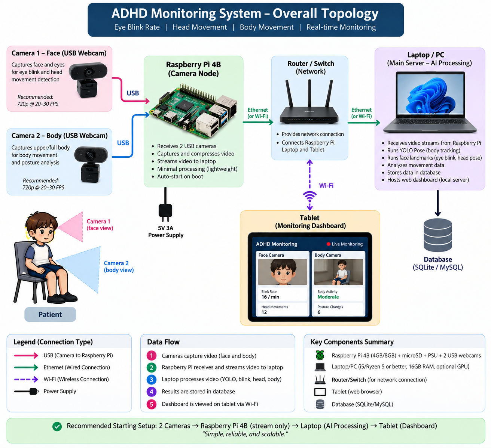

# Raspberry Pi Camera Node — Setup Log



This file is the running handoff record for Raspberry Pi setup. Update it after every completed check or configuration change. Never store passwords, access keys, or other secrets here.

## Target configuration

- Hostname: `adhd-camera`
- SSH user: `piadmin`
- Role: two-camera Raspberry Pi streaming node
- Main server: Windows laptop

## 2026-09-17 — Initial network discovery

### Completed from the Windows laptop

- Resolved `adhd-camera.local` to IPv4 address `192.168.1.26`.
- Also discovered the Pi link-local IPv6 address `fe80::2ecf:67ff:fe93:52ed`.
- Confirmed the laptop Wi-Fi address is `192.168.1.20`; both devices are on the `192.168.1.x` subnet.
- Found a Raspberry Pi ARP entry on the local network; the deployment-specific IP and MAC address are intentionally omitted from the shareable log.
- Tested TCP port 22. Result: SSH is not currently reachable (`TcpTestSucceeded: False`).
- Tested ICMP ping. Result: three timeouts. This may mean the Pi is offline/not fully booted, Wi-Fi client isolation is enabled, or inbound traffic is blocked; ping failure alone does not prove the Pi is offline.
- Attempted non-interactive SSH only to test connectivity. No credentials were transmitted or stored, and no Raspberry Pi changes were made.

### Current blocker

Resolved on a later check: the laptop can now reach SSH port 22. Password-based manual login works for the user, but the automation connection is not yet authorized.

### 2026-09-17 — SSH recheck

- `adhd-camera.local` port 22 now reports `TcpTestSucceeded: True` over the local Wi-Fi IPv6 link.
- A non-interactive login as `piadmin` reached the SSH server but was rejected with `Permission denied (publickey,password)`; this confirms networking and SSH service are working, with authentication still required.
- Created a dedicated laptop SSH key named `adhd_camera_node_ed25519` for this local camera node. The existing unrelated VPS deployment key was not reused.
- The private key remains in the Windows user's `.ssh` directory and is not stored in this project or documentation.
- Pending: add the dedicated public key to `/home/piadmin/.ssh/authorized_keys` from the user's already-authenticated Pi terminal, then verify key-based access.

## 2026-09-17 — Remote access and camera-node preparation

### Completed

- Logged in successfully as `piadmin` using the user-authorized password. The password was not written to project files, scripts, configuration, or this log.
- Added and verified the dedicated `adhd_camera_node_ed25519` public key. Future automation uses key authentication; password authentication is no longer needed for project work.
- Inspected the Pi:
  - Debian GNU/Linux 13 (Trixie), 64-bit ARM, kernel `6.18.50+rpt-rpi-v8`
  - Python `3.13.5`
  - approximately 57 GB root storage with 48 GB free
  - approximately 4 GB RAM
  - Ethernet `192.168.1.27`; Wi-Fi `192.168.1.26`
  - SSH service active
- Detected one connected camera: Logitech C505 HD Webcam, USB ID `046d:08e3`, serial `B04D0170`.
- Identified its stable capture path: `/dev/v4l/by-id/usb-046d_C505_HD_Webcam_B04D0170-video-index0`.
- Verified `piadmin` is in the `video` group and `/dev/video0` has usable `0660 root:video` permissions plus a user ACL.
- Captured one in-memory test frame successfully at `1280x720`; no raw frame or video was saved.
- Confirmed required OS packages are installed: Python venv/pip, V4L utilities, OpenGL runtime, and GLib runtime.
- Deployed the camera-node source to `/home/piadmin/behavioral-camera-node`.
- Created `.venv-rpi` and installed FastAPI, Uvicorn, OpenCV headless, python-dotenv, and compatible dependencies.
- Updated `requirements-rpi.txt` so Python 3.13 uses NumPy 2.x instead of trying to compile unsupported NumPy 1.26 from source.
- Ran the node in temporary mock mode and verified `/health` returned HTTP 200 with both mock camera roles. The temporary test process was stopped afterward.

### Current physical blocker

Only one USB webcam is connected. Stable Face and Body assignments and the persistent system service must wait until the second webcam is attached and identified. The laptop main server has not been switched to Pi stream URLs.

### Next resume action

Connect the second USB webcam to the Raspberry Pi and leave both cameras attached. Then re-run USB/V4L discovery, assign each physical camera as Face or Body, write `.env.rpi`, install/enable `behavioral-camera-node.service`, verify both live streams from the laptop, and only then switch the main server camera sources.

## 2026-09-17 — Dual-camera deployment and server integration

### Stable camera assignments

- Face: Logitech C505 serial `B04D0170` → `/dev/v4l/by-id/usb-046d_C505_HD_Webcam_B04D0170-video-index0`
- Body: Logitech C505 serial `8DACA170` → `/dev/v4l/by-id/usb-046d_C505_HD_Webcam_8DACA170-video-index0`
- Both devices passed independent in-memory frame tests. No test frames or raw video were saved.
- These serial-based paths remain stable across reboots and USB enumeration changes.

### Pi service configuration

- Created private `/home/piadmin/behavioral-camera-node/.env.rpi` with permissions `0600`.
- Configured `640x480`, target 20 FPS, JPEG quality 75, USB mode, and port 8090.
- Added explicit MJPEG capture selection before resolution/FPS configuration to reduce two-camera USB bandwidth and avoid slow YUYV mode.
- Installed and enabled `behavioral-camera-node.service`; it starts automatically at boot and restarts after failures.
- Both cameras report `CONNECTED`, zero failed frames, and actual source capture near 10 FPS. The service emits the latest frame at the configured stream interval.

### Network correction

- The router/local network allowed laptop-to-Pi traffic over IPv6 link-local but not the tested IPv4 paths.
- Changed the camera node listener from IPv4-only `0.0.0.0` to IPv6 `::`.
- Verified from Windows: `adhd-camera.local` port 8090 is reachable and `/health` returns HTTP 200.
- Verified and decoded one `640x480` JPEG frame from each network stream on the laptop.

### Main-server integration

- Updated laptop `.env`:
  - `FACE_CAMERA_SOURCE=http://adhd-camera.local:8090/stream/face`
  - `BODY_CAMERA_SOURCE=http://adhd-camera.local:8090/stream/body`
  - capture profile `640x480 @ 20 FPS`
- Started a temporary Main Server validation instance on port 8001 using the new configuration.
- Main Server reported both camera sources `CONNECTED`, `640x480`, zero failed frames, approximately 16–17 received-stream FPS, and low frame latency during the check.
- `/api/hardware/rpi-health` reported `configured: true`, `reachable: true`, camera-node role, USB mode, and both Pi cameras connected.
- Stopped the temporary validation server after testing.
- Full local automated suite: 43 tests passed; dashboard JavaScript syntax validation passed.

### Remaining operator action

The existing port-8000 Main Server process is elevated/admin-owned, so Windows denied the automated stop request. Its `.env` is already updated. Close its existing administrator server window (or press `Ctrl+C` there), then run `run_windows.bat` once. The restarted production instance will use the Raspberry Pi streams.

### Operational URLs

- Pi health: `http://adhd-camera.local:8090/health`
- Face stream: `http://adhd-camera.local:8090/stream/face`
- Body stream: `http://adhd-camera.local:8090/stream/body`
- Main dashboard after restart: `http://127.0.0.1:8000/`

## 2026-09-17 — Requested camera profile adjustment

- Researcher-requested settings: width `360`, height `240`, capture FPS `30`.
- Updated the laptop `.env` and Pi `.env.rpi` to those requested values.
- The Logitech C505 does not expose a native `360x240` UVC mode. Both cameras negotiate their nearest physical mode, `320x240`, at approximately 15 FPS while operating together.
- Updated the Pi stream encoder to normalize each outgoing network frame to exactly `360x240`, while retaining the honest physical capture size/FPS in `/health` diagnostics.
- Verified from the laptop that both Face and Body MJPEG streams decode to exactly `(240, 360, 3)` and both Pi cameras remain `CONNECTED` with zero failed frames.
- The requested `30 FPS` remains the stream/config target; it does not manufacture new physical frames when the webcams supply approximately 15 FPS. This distinction must remain visible in diagnostics.
- Re-ran the software suite after the change: 43 tests passed.

## 2026-09-17 — Physical setup reference

- Generated and saved a professional two-camera installation diagram at `docs/assets/recommended-two-camera-setup.png`.
- Added `PHYSICAL_CAMERA_SETUP.md` covering participant posture, starting distances/heights, framing, lighting, room layout, cable safety, and calibration caveats.
- Added `CALIBRATION_VALIDATION_PLAN.md` as the prioritized remaining-work, calibration, validation, reliability, and image-based documentation plan.

### Next action on the Raspberry Pi

Using a monitor and keyboard connected to the Pi, sign in and run:

```bash
sudo systemctl enable --now ssh
sudo systemctl status ssh --no-pager
hostname
hostname -I
ip -br address
```

Expected SSH status: `active (running)`. Keep the Pi powered on and connected to the same router as the laptop. Do not copy the password into this file or chat.

### Resume point

After the user confirms that SSH shows `active (running)`, retest from Windows:

```powershell
Test-NetConnection adhd-camera.local -Port 22
ssh piadmin@adhd-camera.local
```

Once SSH succeeds, continue with OS inspection/update, camera-tool installation, dual-camera discovery, stable device mapping, camera-node deployment, service installation, and laptop integration. Record each completed step below.

## Camera-node to main-server connection design

- The Raspberry Pi runs the lightweight camera-node service on TCP port `8090`; AI processing remains on the laptop.
- Face stream: `http://adhd-camera.local:8090/stream/face`
- Body stream: `http://adhd-camera.local:8090/stream/body`
- Health endpoint: `http://adhd-camera.local:8090/health`
- After both Pi streams are verified, the laptop `.env` camera sources will be changed from local USB indexes to those two stream URLs and the main server will be restarted.
- Current laptop `.env` still uses direct local USB sources (`FACE_CAMERA_SOURCE=1`, `BODY_CAMERA_SOURCE=2`). No source switch has been performed yet.
