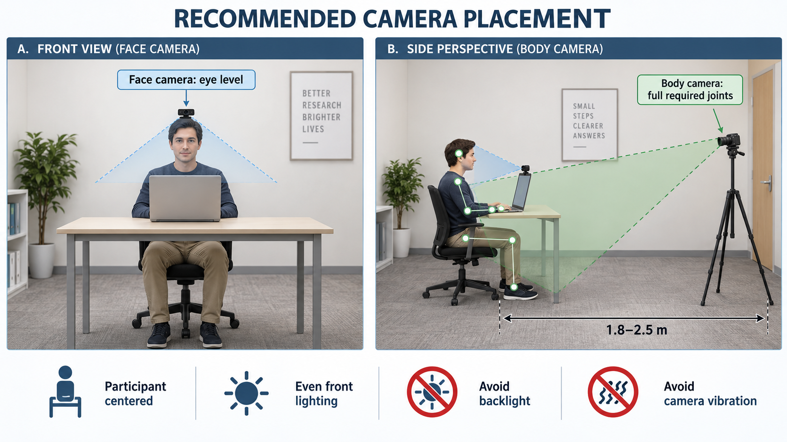

# Behavioral Monitoring System — Startup and Connection Guide

Kini nga guide para sa adlaw-adlaw nga pagtaod, pagpaandar, pag-connect, pag-calibrate, ug pag-shutdown sa complete system.

**Current CLEAN package default:** ang Face camera kay local Windows camera `0`; ang Body camera kay Raspberry Pi stream `http://adhd-camera.local:8090/stream/body`. Ang ubos nga dual-Pi-camera instructions para sa alternate/full Pi camera setup. Para sa current client one-click launch ug first-time computer setup, basaha ang `docs/Behavior_Monitor_Startup_and_Raspberry_Pi_Connection_Guide.docx`. Ang `run_windows.bat` na mismo mo-setup sa first-time computer ug mo-generate sa private local login credentials; ayaw i-apil ang generated `.env` sa shared ZIP.

## A. Mga device nga kinahanglan

- Raspberry Pi 4B camera node ug sakto nga power supply
- Duha ka Logitech C505 USB webcam
- Router/switch
- Ethernet cable para sa Raspberry Pi ug Main Server kung mahimo
- Windows laptop/PC nga Main Server
- Tablet para sa participant Attention Task/dashboard
- Stable camera mounts/tripods
- Tape measure para sa 40 cm Face camera placement

## B. Physical connection — system OFF pa

1. Ayaw una i-power ang Raspberry Pi.
2. Isaksak ang **Face camera** sa Raspberry Pi.
   - Assigned serial: `B04D0170`
   - Kini ang camera nga duol sa participant.
3. Isaksak ang **Body camera** sa Raspberry Pi.
   - Assigned serial: `8DACA170`
   - Kini ang camera nga makakita sa required body joints.
4. Ikonekta ang Raspberry Pi ngadto sa router/switch gamit Ethernet.
5. Ikonekta ang Main Server laptop sa parehas nga router/network. Ethernet ang preferred.
6. Ikonekta ang tablet sa parehas nga local network pinaagi sa Wi-Fi.
7. I-secure ang camera mounts ug cables. Dili dapat maigo sa tiil o mag-uyog during recording.

## C. Camera placement

### Face camera

1. Ibutang sa eye level o gamay ibabaw sa eye line.
2. Sukda ang approximately **40 cm** gikan sa camera lens ngadto sa face.
3. Green zone sa calibration guide: **35–45 cm**.
4. Dapat makita ang full face, duha ka mata, jaw/contour, ug upper shoulders.
5. Likayi ang strong window/backlight sa luyo sa participant.

### Body camera

1. Sugdi sa approximately `1.8–2.5 m` gikan sa participant.
2. Camera height: approximately `1.0–1.3 m`, then adjust based sa chair/participant.
3. Dapat makita ang tanang selected joints. Kung Full Body ang profile, apil ang ankles/feet.
4. Usa ra ka participant ang naa sa frame.



## D. Recommended power-on order

1. Paandara ang router/switch ug hulata nga stable ang network lights.
2. Isaksak ang Raspberry Pi power.
3. Hulata approximately 60–90 seconds para maka-boot ug maka-start ang camera service.
4. Paandara ang Main Server laptop.
5. Paandara/i-connect ang tablet sa parehas nga network.

## E. Verify ang Raspberry Pi gikan sa Windows

Ablihi ang PowerShell sa Main Server.

### 1. Check hostname/network

```powershell
ping adhd-camera.local
```

Kung walay ping reply, dili dayon pasabot nga offline—ang ubang device mo-block og ping. I-test ang required ports:

```powershell
Test-NetConnection adhd-camera.local -Port 22
Test-NetConnection adhd-camera.local -Port 8090
```

Expected: `TcpTestSucceeded : True`.

### 2. Check camera-node health without SSH

Sa browser, ablihi:

```text
http://adhd-camera.local:8090/health
```

Then verify both streams:

```text
http://adhd-camera.local:8090/stream/face
http://adhd-camera.local:8090/stream/body
```

Expected: both camera roles are connected and the correct physical views appear.

## F. SSH connection — troubleshooting/admin only

Daily operation normally **dili kinahanglan mag-SSH** kay automatic-start ang Pi service.

Connect:

```powershell
ssh piadmin@adhd-camera.local
```

Kung dedicated SSH key ang gamiton:

```powershell
ssh -i "$env:USERPROFILE\.ssh\adhd_camera_node_ed25519" piadmin@adhd-camera.local
```

Ayaw ibutang ang actual password o private-key contents sa guide. Kung password prompt, gamita ang private password nga gi-set sa authorized operator.

Useful Pi commands after login:

```bash
hostname
hostname -I
sudo systemctl status behavioral-camera-node.service --no-pager
curl http://127.0.0.1:8090/health
```

Tan-aw sa recent logs:

```bash
sudo journalctl -u behavioral-camera-node.service -n 100 --no-pager
```

Live logs:

```bash
sudo journalctl -u behavioral-camera-node.service -f
```

Press `Ctrl+C` para undangon ang live-log display; dili niini i-stop ang camera service.

Restart camera node service:

```bash
sudo systemctl restart behavioral-camera-node.service
sudo systemctl status behavioral-camera-node.service --no-pager
```

Verify camera mapping:

```bash
ls -l /dev/v4l/by-id/
```

Expected mappings:

- Face: `usb-046d_C505_HD_Webcam_B04D0170-video-index0`
- Body: `usb-046d_C505_HD_Webcam_8DACA170-video-index0`

Exit SSH:

```bash
exit
```

## G. Start ang Windows Main Server

1. Ablihi ang PowerShell.
2. Adto sa project folder:

```powershell
cd "C:\Behavior-Monitor-Research-Console-CLEAN"
```

3. Start:

```powershell
.\run_windows.bat
```

Expected terminal information:

- Mode: `REAL`
- Face camera: Pi Face stream URL
- Body camera: Pi Body stream URL
- Raw recording: `OFF`
- Research login: `ENABLED`
- Local URL: `http://127.0.0.1:8000`
- LAN dashboard URL: `http://<laptop-IP>:8000`

Kung mo-display og `SERVER ALREADY RUNNING on port 8000`, ayaw pag-open og second copy. Gamita ang existing server o adto sa existing terminal ug press `Ctrl+C` before restart.

## H. Researcher login

1. Sa Main Server browser, ablihi:

```text
http://127.0.0.1:8000
```

2. I-enter ang researcher access key nga naa locally sa `.env` under `RESEARCHER_ACCESS_KEY`.
3. Ayaw i-share, i-screenshot, o i-copy ang access key ngadto sa documentation.

## I. Hardware validation

Open:

```text
http://127.0.0.1:8000/hardware
```

Verify:

- Pi node reachable
- Face camera connected
- Body camera connected
- Face/body streams dili baliktad
- Actual FPS ug latency acceptable
- Raw recording OFF

Sunod, open Live Monitor:

```text
http://127.0.0.1:8000/live-monitor
```

Traffic-light meaning:

- Green: ready
- Yellow: review/correct before recording
- Red: do not record

## J. Guided calibration

Open:

```text
http://127.0.0.1:8000/calibration
```

Follow in order:

1. **Readiness** — review automatic checks.
2. **Placement** — confirm camera roles, lighting, framing, and participant position.
3. **Face calibration**
   - Adjust distance until green around 40 cm.
   - Calibrate Eyes for 10 seconds.
   - Calibrate Neutral Head for 10 seconds.
   - Follow animated `UP`, `DOWN`, `LEFT`, `RIGHT`, and `CENTER` verification.
4. **Body check** — stillness, arms, torso, and selected leg movement.
5. **Attention Task practice** — confirm keyboard/touch response.
6. **Review** — save draft, inspect, then accept the calibration profile.

Do not start a real session kung Yellow/Red ang critical indicator o wala pa accepted calibration profile.

## K. Connect ang tablet

1. Tan-awa ang `LAN dashboard` address sa Main Server terminal, example:

```text
http://192.168.x.x:8000
```

2. Sa tablet browser, ablihi ang LAN address.
3. Para diretso sa participant task:

```text
http://<laptop-LAN-IP>:8000/attention-task
```

4. Kung dili ma-open:
   - Confirm same network ang tablet ug laptop.
   - Confirm sakto/current ang laptop IP.
   - Allow port 8000 sa Windows Private Network firewall.
   - Ayaw gamita ang `127.0.0.1` sa tablet; kana para laptop mismo.

## L. Start a participant session

1. Sa Overview, select o create coded Participant ID.
2. Verify accepted calibration profile.
3. Press **Start session**.
4. Verify Green indicators and live measurements.
5. Open/run Attention Task sa tablet.
6. Human sa test, press **Stop session**.
7. Review ang saved record/report before leaving the station.

## M. Correct shutdown order

1. Stop any active participant session.
2. Confirm results saved; perform database backup if required.
3. Stop the Windows Main Server using `Ctrl+C` sa server terminal.
4. SSH ngadto sa Pi:

```powershell
ssh piadmin@adhd-camera.local
```

5. Clean shutdown:

```bash
sudo shutdown -h now
```

6. Hulata nga mo-stop ang Pi activity light before unplugging power.
7. Power off tablet, laptop, ug router/switch as required.

Ayaw diretso ibton ang Raspberry Pi power while active kay posible ma-corrupt ang microSD.

## N. Daily quick-start checklist

```text
[ ] Two cameras securely connected to Pi
[ ] Ethernet/network connected
[ ] Router ON
[ ] Raspberry Pi ON; wait 60–90 seconds
[ ] /health reachable; both camera roles connected
[ ] Main Server run_windows.bat started once
[ ] Researcher login successful
[ ] Hardware validation reviewed
[ ] Face distance green near 40 cm
[ ] Eye and neutral-head calibration completed
[ ] UP/DOWN/LEFT/RIGHT verified
[ ] Body movement verification completed
[ ] Tablet Attention Task practice completed
[ ] Calibration profile accepted
[ ] Participant selected before Start session
```

## O. Common problems

| Problem | Meaning/action |
|---|---|
| `adhd-camera.local` not found | Check same LAN, Ethernet, Pi power; try Pi IP if known |
| Port 22 fails | SSH service/network unavailable |
| Port 8090 fails | Camera-node service stopped or Pi unavailable |
| One camera offline | Check USB cable, stable serial mapping, restart service |
| Face/body views reversed | Verify camera serial mappings; do not swap role URLs |
| Server already running | Use the existing copy or stop it before restarting |
| Tablet cannot open `127.0.0.1` | Use laptop LAN IP, not localhost |
| Calibration stays required | Keep face visible and stable, rerun 10-second baseline |
| Distance inaccurate | Confirm physical 40 cm with tape; camera FOV/zoom affects estimate |
| Yellow/Red indicator | Read the exact reason and correct FPS, latency, tracking, or people count |

## P. Related detailed documents

- `docs/USER_OPERATIONS_MANUAL.md`
- `docs/CREDENTIALS_AND_SECURITY.md`
- `PHYSICAL_CAMERA_SETUP.md`
- `CALIBRATION_VALIDATION_PLAN.md`
- `RASPBERRY_PI_SETUP_LOG.md`
