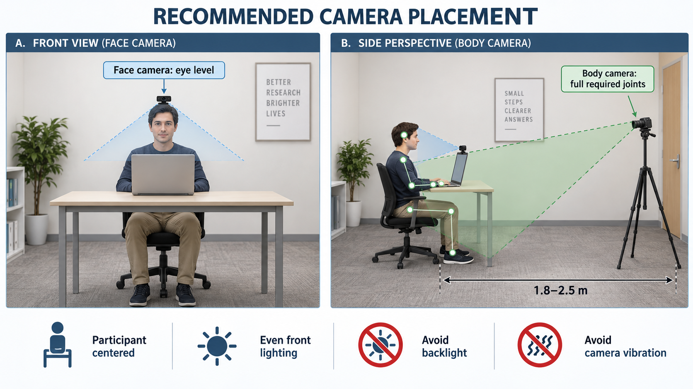

# Behavioral Monitoring System — Startup and Connection Guide

This guide covers the complete daily procedure for installing, powering, connecting, calibrating, operating, and shutting down the system.

## 1. Required devices

- Raspberry Pi 4B camera node with the correct power supply
- Two Logitech C505 USB webcams
- Router or network switch
- Ethernet cables for the Raspberry Pi and Main Server whenever possible
- Windows laptop/PC used as the Main Server
- Tablet used for the participant Attention Task/dashboard
- Stable camera mounts or tripods
- Tape measure for the 40 cm Face camera position

## 2. Physical connections — power still OFF

1. Do not power the Raspberry Pi yet.
2. Connect the **Face camera** to the Raspberry Pi.
   - Assigned serial: `B04D0170`
   - This is the camera positioned near the participant's face.
3. Connect the **Body camera** to the Raspberry Pi.
   - Assigned serial: `8DACA170`
   - This camera must cover all required body joints.
4. Connect the Raspberry Pi to the router/switch using Ethernet.
5. Connect the Main Server laptop to the same network. Ethernet is preferred.
6. Connect the tablet to the same local network through Wi-Fi.
7. Secure all camera mounts and cables. Nothing should move or create a trip hazard during recording.

## 3. Camera placement

### Face camera

1. Position the camera at eye level or slightly above the eye line.
2. Measure approximately **40 cm** from the camera lens to the participant's face.
3. The green calibration range is **35–45 cm**.
4. The complete face, both eyes, jaw/contour, and upper shoulders must remain visible.
5. Avoid strong windows or backlighting behind the participant.

### Body camera

1. Start approximately `1.8–2.5 m` from the participant.
2. Start with a camera height of approximately `1.0–1.3 m`, then adjust for the chair and participant.
3. All selected joints must remain visible. A Full Body profile must include the ankles and feet.
4. Only one participant should appear in the body frame.



## 4. Recommended power-on order

1. Power on the router/switch and wait for stable network lights.
2. Connect power to the Raspberry Pi.
3. Wait approximately 60–90 seconds for the Pi to boot and start the camera-node service.
4. Power on the Main Server laptop.
5. Power on the tablet and connect it to the same network.

## 5. Verify the Raspberry Pi from Windows

Open PowerShell on the Main Server.

### Check the hostname and network

```powershell
ping adhd-camera.local
```

Some devices block ping, so a failed ping does not always mean the Pi is offline. Test the required ports:

```powershell
Test-NetConnection adhd-camera.local -Port 22
Test-NetConnection adhd-camera.local -Port 8090
```

Expected result: `TcpTestSucceeded : True`.

### Check camera-node health without SSH

Open in the Main Server browser:

```text
http://adhd-camera.local:8090/health
```

Verify both camera streams:

```text
http://adhd-camera.local:8090/stream/face
http://adhd-camera.local:8090/stream/body
```

Both roles should report connected and display the correct physical view.

## 6. SSH connection — administration and troubleshooting

SSH is normally **not required during daily operation** because the camera-node service starts automatically.

Connect from PowerShell:

```powershell
ssh piadmin@adhd-camera.local
```

To use the dedicated SSH key:

```powershell
ssh -i "$env:USERPROFILE\.ssh\adhd_camera_node_ed25519" piadmin@adhd-camera.local
```

Do not place the actual password or private-key contents in this guide. If prompted, use the private password held by the authorized operator.

Useful commands after connecting:

```bash
hostname
hostname -I
sudo systemctl status behavioral-camera-node.service --no-pager
curl http://127.0.0.1:8090/health
```

View recent service logs:

```bash
sudo journalctl -u behavioral-camera-node.service -n 100 --no-pager
```

Follow live logs:

```bash
sudo journalctl -u behavioral-camera-node.service -f
```

Press `Ctrl+C` to stop viewing live logs. This does not stop the service.

Restart the camera-node service:

```bash
sudo systemctl restart behavioral-camera-node.service
sudo systemctl status behavioral-camera-node.service --no-pager
```

Verify stable camera assignments:

```bash
ls -l /dev/v4l/by-id/
```

Expected mappings:

- Face: `usb-046d_C505_HD_Webcam_B04D0170-video-index0`
- Body: `usb-046d_C505_HD_Webcam_8DACA170-video-index0`

Exit SSH:

```bash
exit
```

## 7. Start the Windows Main Server

1. Open PowerShell.
2. Change to the project directory:

```powershell
cd "C:\Behavior-Monitor-Research-Console-CLEAN"
```

3. Start the server:

```powershell
.\run_windows.bat
```

Expected terminal information:

- Mode: `REAL`
- Face camera: Raspberry Pi Face stream URL
- Body camera: Raspberry Pi Body stream URL
- Raw recording: `OFF`
- Research login: `ENABLED`
- Local URL: `http://127.0.0.1:8000`
- LAN dashboard URL: `http://<laptop-IP>:8000`

If the terminal reports `SERVER ALREADY RUNNING on port 8000`, do not launch a second copy. Use the existing server or press `Ctrl+C` in its original terminal before restarting it.

## 8. Researcher login

1. Open this address on the Main Server:

```text
http://127.0.0.1:8000
```

2. Enter the researcher access key configured locally in `.env` as `RESEARCHER_ACCESS_KEY`.
3. Never place the actual key in screenshots, documentation, chat messages, or reports.

## 9. Hardware validation

Open:

```text
http://127.0.0.1:8000/hardware
```

Verify:

- Raspberry Pi node is reachable
- Face camera is connected
- Body camera is connected
- Face and Body roles are not reversed
- Measured FPS and latency are acceptable
- Raw recording is OFF

Then open:

```text
http://127.0.0.1:8000/live-monitor
```

Traffic-light meanings:

- **Green:** ready
- **Yellow:** review and correct before recording
- **Red:** do not record

## 10. Guided calibration

Open:

```text
http://127.0.0.1:8000/calibration
```

Complete the steps in order:

1. **Readiness:** review automatic system checks.
2. **Placement:** confirm camera roles, lighting, framing, and participant position.
3. **Face calibration:**
   - Adjust the distance until the 40 cm guide becomes green.
   - Run the 10-second Eye calibration.
   - Run the 10-second Neutral Head calibration.
   - Follow the animated `UP`, `DOWN`, `LEFT`, `RIGHT`, and `CENTER` verification.
4. **Body check:** verify stillness, arms, torso, and selected leg movement.
5. **Attention Task practice:** verify keyboard or touch input.
6. **Review:** save a draft, inspect it, and accept the calibration profile.

Do not start a real session while a critical indicator is Yellow/Red or before an appropriate calibration profile has been accepted.

## 11. Connect the tablet

1. Read the `LAN dashboard` address shown in the Main Server terminal, for example:

```text
http://192.168.x.x:8000
```

2. Open that LAN address in the tablet browser.
3. To open the participant task directly:

```text
http://<laptop-LAN-IP>:8000/attention-task
```

If the tablet cannot connect:

- Confirm that the tablet and laptop use the same local network.
- Confirm the laptop's current LAN IP.
- Allow TCP port 8000 on the Windows Private Network firewall.
- Do not use `127.0.0.1` on the tablet; that address refers to the tablet itself.

## 12. Start a participant session

1. Select or create a coded Participant ID on the Overview page.
2. Confirm that the correct calibration profile is accepted.
3. Press **Start session**.
4. Confirm Green indicators and valid live measurements.
5. Run the Attention Task on the tablet.
6. Press **Stop session** after testing.
7. Review the saved record/report before releasing the station.

## 13. Correct shutdown procedure

1. Stop any active participant session.
2. Confirm that results are saved and create a database backup if required.
3. Stop the Windows Main Server with `Ctrl+C` in its terminal.
4. Connect to the Raspberry Pi:

```powershell
ssh piadmin@adhd-camera.local
```

5. Shut down the Pi cleanly:

```bash
sudo shutdown -h now
```

6. Wait for Pi activity to stop before disconnecting power.
7. Power off the tablet, laptop, and network equipment as required.

Never disconnect Raspberry Pi power while it is active because this can corrupt the microSD card.

## 14. Daily quick-start checklist

```text
[ ] Both cameras securely connected to the Raspberry Pi
[ ] Ethernet/network connected
[ ] Router/switch powered on
[ ] Raspberry Pi powered on; waited 60–90 seconds
[ ] /health reachable and both cameras connected
[ ] run_windows.bat started once
[ ] Researcher login successful
[ ] Hardware validation reviewed
[ ] Face distance green near 40 cm
[ ] Eye and Neutral Head calibration completed
[ ] UP/DOWN/LEFT/RIGHT/CENTER verified
[ ] Body movement verification completed
[ ] Tablet Attention Task practice completed
[ ] Calibration profile accepted
[ ] Participant selected before starting the session
```

## 15. Common problems

| Problem | Meaning or action |
|---|---|
| `adhd-camera.local` is not found | Check the LAN, Ethernet cable, and Pi power; use the Pi IP if required |
| Port 22 fails | SSH service or network connection is unavailable |
| Port 8090 fails | Camera-node service has stopped or the Pi is unavailable |
| One camera is offline | Check its USB connection and stable serial mapping; restart the service |
| Face and Body views are reversed | Verify serial-to-role mappings; do not swap stream URLs |
| Server already running | Use the existing process or stop it before restarting |
| Tablet cannot open `127.0.0.1` | Use the Main Server's LAN IP, not localhost |
| Calibration remains required | Keep the complete face stable and visible, then repeat the baseline |
| Distance appears inaccurate | Confirm 40 cm with a tape measure; camera FOV and zoom affect the estimate |
| Indicator is Yellow or Red | Read the exact reason and correct FPS, latency, tracking, or people count |

## 16. Related documentation

- `STARTUP_AND_CONNECTION_GUIDE.md` — Bisaya version
- `docs/USER_OPERATIONS_MANUAL.md`
- `docs/CREDENTIALS_AND_SECURITY.md`
- `PHYSICAL_CAMERA_SETUP.md`
- `CALIBRATION_VALIDATION_PLAN.md`
- `RASPBERRY_PI_SETUP_LOG.md`
