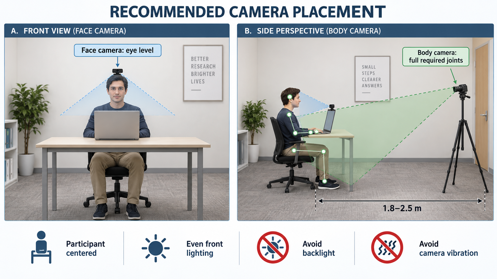
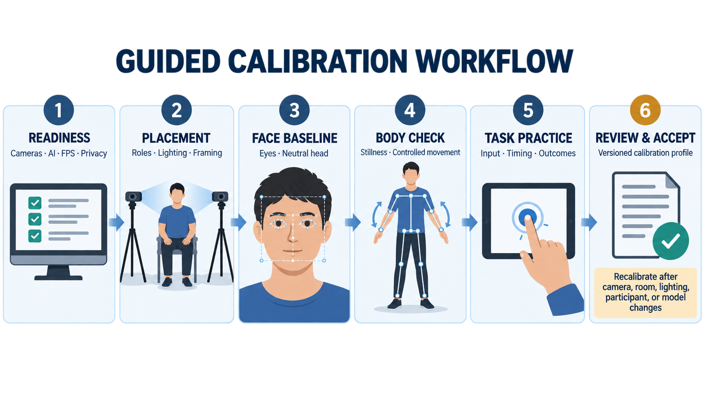

# Behavioral Monitoring System — Operations Manual

> Research support software, not a diagnostic instrument. A qualified researcher must review data quality and interpretation.

## 1. System at a glance

Two USB cameras connect to the Raspberry Pi camera node. The Pi exposes face and body MJPEG streams across the local network. The Windows laptop receives the streams, performs face/body analysis, stores measurements in SQLite, and serves the researcher dashboard and tablet Attention Task.

Normal addresses:

- Main laptop: `http://127.0.0.1:8000`
- Tablet: `http://<laptop-LAN-IP>:8000/attention-task`
- Pi health: `http://adhd-camera.local:8090/health`
- Pi face stream: `http://adhd-camera.local:8090/stream/face`
- Pi body stream: `http://adhd-camera.local:8090/stream/body`

The Mock/demo selector is intentionally not exposed in Settings. Production camera mode is controlled by the server environment so an operator cannot accidentally switch a real session to synthetic data.

## 2. Start and stop

1. Power the router/switch, Raspberry Pi, camera mounts, and laptop.
2. Wait about one minute, then on the laptop run `run_windows.bat` from the project folder.
3. If the terminal says **SERVER ALREADY RUNNING**, do not launch another copy. Open the displayed URL or close the original server window before restarting.
4. Sign in with the locally configured researcher access key.
5. Open **Settings → Diagnostics**, then **Guided calibration**.
6. Stop using `Ctrl+C` in the server terminal. Do not power off during an active session or backup.

## 3. Pre-session workflow

Open `/calibration` and finish all six steps:

1. **Readiness:** cameras, AI tracking, actual FPS, and privacy checks.
2. **Placement:** verify camera roles, even light, framing, and participant position.
3. **Face baseline:** 10-second natural open-eye baseline and 10-second neutral-head baseline; then manually test 8–10 blinks and four head directions.

Head direction displays `CALIBRATE` until the neutral-head baseline succeeds. Direction and magnitude are relative to that baseline; do not use uncalibrated raw Euler angles as participant movement.

The on-screen calibration coach provides an animated head, seconds countdown, progress bar, and live expected-versus-detected direction. Follow `CENTER → UP → DOWN → LEFT → RIGHT → CENTER`. Left and right always refer to the participant's own left/right, not the mirrored preview. A direction passes only after consecutive matching readings; use Retry if framing or tracking is lost.

The coach also shows an **estimated face-camera distance**: red means clearly too near/far, yellow means adjustment is still recommended, and green means the estimate is within **35–45 cm**, centered on the approved **40 cm** setup. This is a monocular estimate derived from apparent eye spacing and an assumed camera field of view; verify placement with a physical tape measure, especially when the camera model or zoom changes.
4. **Body check:** stillness baseline, left/right arm movement, torso lean, and relevant leg movement.
5. **Task practice:** confirm instructions, input device, timing, pause/abort, and reconnect behavior.
6. **Review:** save a draft, inspect it, then accept. Accepted profiles are immutable; recalibration creates a new profile.

Full calibration is a site/device setup task performed by the Owner/Admin or an authorized device operator. It is not repeated for every participant and must not be presented as a diagnostic activity. Recalibrate only when the camera or mount is moved, the room or lighting changes materially, camera roles or lenses change, or the tracking/model configuration changes.

Before each recorded participant session, the operator selects the participant and presses **Start session**. The application silently samples face camera, body camera, tracking, framing, measured FPS, and privacy state for two seconds. If the check passes, the activity opens automatically. If it fails, the session is not created and the operator receives one focused correction. The participant only sits comfortably and looks toward the cameras; there is no second manual calibration workflow.

## 4. Camera targets and honest telemetry

The Live Monitor uses an explainable traffic-light indicator:

- **Green — Ready:** connected, adequate measured FPS, acceptable latency/inference time, and valid tracking.
- **Yellow — Review:** recording should pause while the operator corrects low FPS, elevated delay, or missing face/body tracking.
- **Red — Do not record:** disconnected/stale stream, critically low FPS, stalled inference, or multiple people in the body frame.

Hover over an indicator or read the line below it for the exact reason. The indicator is a data-quality gate, not an ADHD result.

The configured output target for each current Pi stream is `360 × 240 @ 30 FPS`. The Logitech C505 hardware presently negotiates approximately `320 × 240 @ 15 FPS`; the node resizes output to `360 × 240` but cannot manufacture real captured frames. The Settings diagnostics therefore show **requested** and **received/measured** values separately.

Do not treat an entered “30 FPS” value as evidence of 30 physical frames per second. Use the received FPS and latency shown in diagnostics.

Face framing must keep both eyes, the face contour, jaw, and upper shoulders visible. Body framing must keep every selected joint visible. Avoid windows behind the participant, camera vibration, auto-exposure hunting, multiple people, and background screens with moving content.

## 5. Running a recorded session

1. Select/create the participant ID; never use the participant's name as the code.
2. Confirm the accepted calibration profile matches the room and participant.
3. Start the monitoring session and verify both live status indicators remain tracking.
4. Launch the participant Attention Task only after the practice trial.
5. Watch warnings for camera loss, multiple persons, low FPS, or stale streams.
6. Stop the session deliberately. Review the summary and records before releasing the station.

### Choosing the participant task

The participant screen is always attached to the participant whose monitoring session is active. Verify the participant code and name shown at the top before practice or recording. The screen suggests an age profile from the saved birth date or age group, but the operator must confirm it.

Open **Research Tasks** on the researcher laptop and create a secure participant pairing. The QR/link contains a random capability that expires after 30 minutes and permits only participant practice and assigned trials; it cannot open records, settings, or researcher controls. On the tablet, scan the QR and keep the neutral **Please wait** screen open. Use **Configure & launch** on the researcher laptop. Never share the protected `/attention-task/operator` route with a participant.

The new-session activity is **Pop the Balloon**:

- **Easy — Pop Any Balloon:** every displayed balloon is a target; large, slow balloons and longer response time.
- **Moderate — Target Color:** pop only the named color; other colors are distractors.
- **Hard — Target Color:** smaller/faster balloons, shorter display time, randomized waits, and more distractors.
- **Standard:** the normal adult/research timing preset; it is not proof of clinical standardization.

Correct-pop goal presets are 10, 15, 20, and 30. A custom goal may be 5–50; the overall recommended default is 20. Age-based starting suggestions are Child 6–9: 15/Easy; Pre-teen 10–12: 20/Moderate; Teen 13–17: 30/Moderate; Adult 18+: 30/Standard. The operator may change the recommendation before practice.

Use this exact workflow: pair/open participant screen → start or repeat five-balloon practice → confirm the participant is ready → begin recorded game. Practice is not saved. During recording, only one balloon is active. The operator may pause, resume, or end early with a reason. The activity automatically completes when the correct-pop goal is reached; hidden guards stop it after three times the goal in attempts or the configured duration.

The recorded run stores its version, participant, final configuration, random seed, full sequence, and exact balloon metadata/timing. Refreshing or reconnecting replays only an unfinished planned balloon; a completed tap cannot be duplicated. Previous-version session rows stay readable in reports and exports.

“Age fit” and game performance are research usability/measurement information, not a diagnosis or clinical cutoff. Only one recorded activity may run at a time.

Raw video recording is intentionally OFF. Enabling it requires a separate ethics, consent, retention, storage, and access-control decision.

### Research task protocol states

Open **Research tasks** from the sidebar before opening the participant screen. Each protocol has an explicit implementation state:

- **Available:** implemented and permitted by the current validated capabilities.
- **Validation required:** the task definition and storage engine exist, but recorded use is locked until its required measurement provider passes validation.
- **Planned:** documented for a later implementation and cannot be started.

Pop the Balloon is the available recorded participant activity. Its practice balloons are not saved as recorded outcomes. Historical star/circle and other previous-version task records remain readable but cannot be selected for a new session.

**Eye Control Standard** contains a 30-second fixation block plus balanced prosaccade and antisaccade trials. It remains **Validation required** because the current eye/iris landmarks support visualization and blink processing, not validated screen-coordinate gaze. Do not bypass this gate or manually relabel landmark output as gaze data.

**Everyday Planning Pilot** is a locally designed future multi-step task inspired by naturalistic-task research. It is not EPELI and must not be described or reported as an EPELI implementation.

Every research-task run stores its protocol version, randomized seed, configuration snapshot, measurement-provider identity, and validation status. Invalid or lost-tracking trials remain explicit records with a reason; they must not be silently converted to incorrect participant responses.

### Landmark display versus measurement

Eyes and Head Pose may be displayed and measured. Iris, Mouth, and Face Contour may be enabled under **Display** to help the operator inspect tracking, but their **Measure** controls remain locked. Iris display is not gaze tracking, and mouth/contour overlays do not produce validated behavioral variables.

## 6. End-of-day procedure

1. Confirm no session remains active.
2. Review failed/aborted trials and data-quality warnings.
3. Run the database backup from Settings and verify the backup file exists.
4. Verify the downloaded archive with `.venv\Scripts\python.exe scripts\verify_backup.py <backup.zip>`. A valid result must report `"valid": true`.
5. Keep backups encrypted and access-controlled. The ZIP itself is not password-encrypted; store it only on a BitLocker/device-encrypted volume or an institutionally approved encrypted repository.
6. Stop the server and shut down the Raspberry Pi cleanly.

## 7. Troubleshooting quick table

| Symptom | Check | Action |
|---|---|---|
| Server already running | Port 8000 already owned | Use the open copy or stop its terminal; never launch duplicates |
| Pi name not found | Same LAN and mDNS | Try `ping adhd-camera.local`; then use the Pi's current IP |
| Stream unavailable | Pi health and service | Open `/health`, inspect SSH service logs, reconnect USB camera |
| Cameras reversed | Serial-to-role mapping | Face serial ends `B04D0170`; Body serial ends `8DACA170` |
| Low FPS | Received telemetry, USB/network load | Reduce processing rate/resolution; do not relabel target FPS as actual |
| Poor blink detection | eye size, glasses/glare, baseline | Improve framing/light and repeat eye calibration |
| False body movement | mount vibration/background | Stabilize mount, clear background, repeat stillness check |
| Tablet cannot connect | laptop firewall/LAN IP | Use the displayed LAN URL and allow private-network port 8000 |

Detailed build history and validation plans are in `RASPBERRY_PI_SETUP_LOG.md`, `PHYSICAL_CAMERA_SETUP.md`, and `CALIBRATION_VALIDATION_PLAN.md`.
